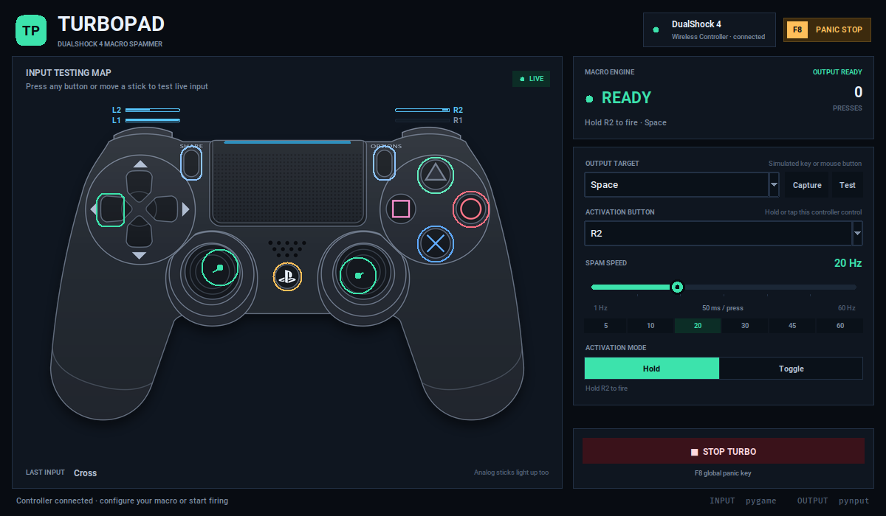

# TurboPad

*All the files in this project were 100% AI generated and I cannot guarantee full functionality of the program. Use at your own risk.*

A cross-platform desktop **rapid-fire macro spammer** for a connected DualShock 4.
TurboPad reads the controller live, lights up a full PS4 input map, and taps a
keyboard key or mouse button while you hold (or toggle) an activation control.

Built with **Python + Tkinter**, **pygame/SDL2** for controller input,
**pynput** for keyboard/mouse output, and **Pillow** for the controller
artwork.



*Preview with simulated controller input.*

```
┌─────────────────────────────────────────────────────────────────────┐
│  TP  TURBOPAD                         ● DualShock 4     F8 PANIC   │
│      DUALSHOCK 4 MACRO SPAMMER                                      │
├───────────────────────────────────────────────┬─────────────────────┤
│  INPUT TESTING MAP                            │  MACRO ENGINE       │
│                                               │  READY      0       │
│            ╭─────────────────╮                │  PRESSES            │
│        L2  │   TOUCHPAD      │  R2            ├─────────────────────┤
│      L1    │  ◁   △   ▷      │    R1          │  OUTPUT TARGET      │
│            │  □   ✕   ○      │                │  [ Space        ]   │
│               ◉       ◉                       │  ACTIVATION         │
│                 PS                            │  [ R2           ]   │
│                                               │  SPAM SPEED  20 Hz  │
│                                               │  ───────●────────   │
│                                               │  MODE [Hold|Toggle] │
├───────────────────────────────────────────────┼─────────────────────┤
│  LAST INPUT  Cross       Analog sticks too    │  ■ STOP TURBO       │
└───────────────────────────────────────────────┴─────────────────────┘
```

## Features

- **Automatic controller detection** over USB or Bluetooth. Hot-plugging is
  handled while the app is open.
- **Live input-testing map** styled as a front view of the DualShock 4, with
  face buttons, D-pad, L1/R1, analog L2/R2, sticks, stick clicks, Share,
  Options, and PS lit in real time.
- **Turbo output** from **1 to 60 presses per second**, with accurate per-press
  timing and automatic key release.
- **Target selector** for keyboard keys and mouse buttons, plus a
  **Capture** button for any key not in the list.
- **Activation selector** for every PS4 control, including analog triggers
  L2/R2.
- **Hold or Toggle** activation mode.
- **Panic stop** with the on-screen button or **F8** (global when available).
- Safety behaviour: a controller disconnect or macro error releases the
  simulated input immediately.
- No console, game, or controller-specific driver required; it works alongside
  normal controller input.

## Quick start

Requirements: **Python 3.10+**. Tkinter is included with most Python installs
(on Debian/Ubuntu install `python3-tk` if needed).

```bash
python3 -m venv .venv
source .venv/bin/activate          # Windows: .venv\Scripts\activate
pip install -r requirements.txt
python run.py
```

Or use the included launcher:

```bash
./run.sh                            # Linux / macOS
run.bat                             # Windows
```

## Using TurboPad

1. Connect the DualShock 4 by USB or pair it over Bluetooth. The status pill in
   the top-right turns green and shows the controller name.
2. Press buttons and move the sticks. The map lights up so you can verify every
   input before configuring the macro.
3. Pick the **output target** to spam (default: `Space`). Use `Capture` to bind
   any keyboard key.
4. Pick the **activation button** (default: `R2`).
5. Set **spam speed** between 1 and 60 Hz. 30 Hz and above is the turbo range.
   For games that sample input once per frame, 20–30 Hz is usually the most
   reliable; higher rates can be useful for event-driven games and macros.
6. Choose **Hold** (fire only while held) or **Toggle** (tap once to start, tap
   again to stop).
7. Press F8 or **STOP TURBO** at any time to stop immediately.

> The target is a keyboard/mouse action. Games that are configured to use the
> corresponding key or mouse button will receive the rapid presses. TurboPad
> intentionally does not install a virtual gamepad driver, which keeps it
> dependency-free and equally usable on Windows, macOS, and Linux.

## Platform notes

### Windows
Works directly. If a game runs as administrator, run TurboPad as administrator
too so simulated input is accepted. Some games ignore synthetic input in
exclusive fullscreen; borderless/windowed mode is usually more reliable.

### macOS
Grant **Accessibility** (and **Input Monitoring**, if prompted) to the terminal
or Python application in *System Settings → Privacy & Security*. Global F8
handling also depends on these permissions.

### Linux
If the controller is visible to the OS but not to TurboPad, make sure your user
can read input devices:

```bash
sudo usermod -aG input "$USER"
# log out and back in
```

The app uses SDL2 through pygame. On **Wayland**, pynput's keyboard/mouse
synthesis can be limited by the compositor; an X11 session gives the broadest
compatibility. Controller input itself is read through SDL and normally works
on both.

## Troubleshooting

| Symptom | Fix |
| --- | --- |
| "No controller detected" | Reconnect by USB, check `ls /dev/input/js*` on Linux, and verify the user is in the `input` group. |
| Controller shows as a generic gamepad | That is fine — SDL's semantic game-controller mapping is used when available, with a DualShock 4 fallback. |
| Output never reaches a game | Try windowed/borderless mode, run both apps with the same privileges, and check macOS Accessibility permissions. |
| F8 only works while the window is focused | The global hotkey listener could not start (common on Wayland or without macOS permissions). The on-screen stop button still works. |
| Stuck key after force-quitting | TurboPad releases inputs on a normal close and on errors. If a crash leaves a key down, tap it once manually. |

## Project layout

```
run.py                     Application entry point
ps4_macro/
  ui.py                    Window, settings, live event loop
  pad_view.py              DualShock 4 input map and live highlights
  controller.py            pygame/SDL controller polling + normalised state
  spammer.py               Turbo timing thread and hold/toggle state machine
  output.py                pynput keyboard/mouse output
  targets.py               Target catalogue and key capture
  widgets.py               Custom slider, segmented control, cards
  theme.py                 Colours and visual tokens
assets/
  ds4_front.png            Dark-theme controller artwork used by the map
  ds4_reference.svg        Original vector source (CC BY 3.0)
  NOTICE.txt               Artwork attribution
tools/build_pad_asset.py   Rebuilds ds4_front.png from the SVG
tests/test_core.py         Spammer, target, and mapping tests
tests/test_controller.py   Normalised controller-state tests
tests/test_assets.py       Bundled artwork and attribution guards
docs/screenshot.png        UI preview
```

## Credits

The controller artwork is derived from
[Dualshock 4 Layout.svg](https://commons.wikimedia.org/wiki/File:Dualshock_4_Layout.svg)
by **Tokyoship**, licensed under
[CC BY 3.0](https://creativecommons.org/licenses/by/3.0/). The vector was
recoloured for TurboPad's dark theme and rasterised; the original source and
full attribution are kept in `assets/`. To rebuild the artwork:

```bash
pip install cairosvg
python tools/build_pad_asset.py
```

## Tests

```bash
python -m unittest discover -s tests -v
```

The tests cover target capture, SDL mapping, hold/toggle behaviour, panic
latching, rate clamping, output release, and the bundled artwork.
